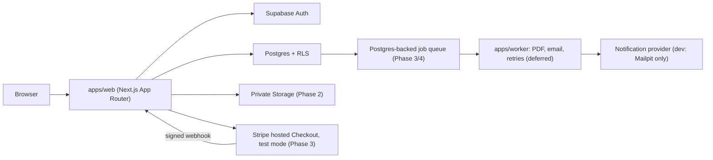

# Architecture

Small-startup architecture: one deployable web app, a managed Postgres with row level security,
and shared TypeScript packages. No microservices or Kubernetes. Split further only when it pays
for itself.

## System context



## Monorepo

pnpm workspaces + Turborepo. Strict TypeScript everywhere (`strict`, `noUncheckedIndexedAccess`).

| Package               | Responsibility                                                                                                         | Depends on                 |
| --------------------- | ---------------------------------------------------------------------------------------------------------------------- | -------------------------- |
| `apps/web`            | Public pages, patient area (`/account`), staff area (`/staff`), server actions, route handlers                         | all packages               |
| `packages/domain`     | Pure TypeScript: order and report state machines, release guard, role checks, GBP formatting                           | none                       |
| `packages/validation` | Zod schemas for every form/API input, error flattening                                                                 | zod                        |
| `packages/ui`         | Design tokens and accessible components (Button, FormField, CheckboxField, Alert, Card, Badge, ErrorSummary, SkipLink) | react, cva, tailwind-merge |
| `packages/config`     | Shared tsconfig and ESLint flat configs                                                                                | none                       |

Packages are consumed as TypeScript source (`transpilePackages` in Next.js). No build step for
packages, which keeps the setup simple. `domain` and `validation` have no framework dependencies so
the Phase 6 Expo app can reuse them unchanged.

Deferred until needed: `apps/worker` (background jobs), `packages/reports` (React PDF templates),
`packages/api-client` (typed client for the mobile app), and a separate staff app.

## Web app structure (`apps/web/src`)

```
app/
  page.tsx, how-it-works/, pricing/, about/, faq/, contact/   public pages
  clinical-safety/, privacy/, terms/, refunds/, complaints/   policy pages (DRAFT)
  (auth)/sign-up, sign-in, forgot-password, reset-password    auth pages + actions.ts
  auth/confirm/route.ts                                       email link verification
  account/                                                    protected patient area
  staff/                                                      protected staff area (verified staff only)
components/                                                   site chrome and forms
lib/                                                          env, supabase clients, auth, rate limit, safe redirect
proxy.ts                                                      session refresh + redirect for protected paths
```

### Request and auth flow

1. `proxy.ts` (Next.js 16's replacement for `middleware.ts`) refreshes the Supabase session cookie
   and redirects signed-out visitors away from `/account` and `/staff`.
2. Every protected layout, page and server action re-checks the user with
   `supabase.auth.getUser()` (validated with the Auth server, not just the cookie).
3. Data access uses the user's own JWT, so Postgres RLS is the final authority. The service role
   key is not used by the web app at all in Phase 1.
4. Forms are server actions with `useActionState`: they work without JavaScript, validate with the
   shared Zod schemas on the server, and return field errors rendered in a GOV.UK-style error
   summary.

### Email verification and password reset

Supabase Auth with `enable_confirmations = true`. Custom email templates
(`supabase/templates/*.html`) link to `/auth/confirm?token_hash=...&type=...`, which calls
`verifyOtp` server-side. This works across devices (no PKCE verifier cookie needed) and keeps
health information out of emails. Locally, all emails are captured by Mailpit (the CLI's
successor to Inbucket).

### Background jobs (designed, not built)

A Postgres-backed queue (pg-boss or Supabase Queues/pgmq) processed by `apps/worker`:
PDF generation, notification sending, Stripe event processing, retries with backoff, idempotency
keys, and dead-letter handling. Chosen over a separate broker to keep one stateful dependency.

## Design system

Defined in `packages/ui/src/styles/tokens.css` as a Tailwind CSS v4 `@theme`.

- **Palette:** deep teal (`teal-700 #0f5e63` primary) and ink (`ink-900 #10242b` text) on a warm
  neutral (`sand-50 #faf8f4` background). Restrained status colours for danger, warning, success.
- **Contrast:** primary text on background is about 15:1; teal-700 on white is about 7.5:1;
  secondary text `ink-600` on white is about 7:1. All component pairs target WCAG 2.2 AA and
  most meet AAA.
- **Type:** system sans-serif for body (no web font download), serif for headings for a calm,
  premium feel. Base font size 18px (112.5%) for older users.
- **Interaction:** minimum 48px tap targets (`min-h-12`), 28px checkboxes, a high-visibility
  focus ring (dark outline plus amber halo), `prefers-reduced-motion` respected, minimal
  animation.
- **Forms:** label, hint and error wired with `aria-describedby`; `aria-invalid` on errors; error
  summary that takes focus and links to fields; date of birth as separate day/month/year inputs.
- **Content:** plain English, short sentences, no jargon, emergency advice on every page.

Components follow shadcn/ui conventions (cva variants, `asChild` via Radix Slot, `cn` helper)
but are kept in-repo so they can be themed and audited.

## Payments and booking (Phase 3)

Development checkout is a local test harness, not Stripe. The patient is told that on the page.
The price, currency (GBP) and product come from the `products` row. The browser cannot set them.

Confirming the test payment posts a signed event to `/api/stripe/webhook`. The route checks the
signature, then the database checks the amount against the checkout row and records the payment
once. The same event is ignored the second time. A different amount is rejected. Live Stripe
keys are refused. No `sk_test_` key is configured, so the Stripe API is not called.

An operations administrator with an authenticator can record a manual payment or a refund. The
refund is stored only. It is not sent to a card provider. The administrator can read payments
and cannot read questionnaires, screenings or reports.

After payment, the patient books a 30-minute slot that a pharmacist has opened. Times are stored
in UTC and shown in Europe/London. Overlapping bookings for the same pharmacist are rejected by
a Postgres exclusion constraint, including two requests at the same moment. The patient can move
an appointment twice, and only when it is more than 24 hours away. A cancellation request frees
the slot and is kept in the appointment history. The consultation is telephone or secure video,
taken from the questionnaire answer.

Payment, a booking and a questionnaire still cannot release a report on their own. Release also
requires a succeeded payment. A recorded refund removes that.

## Clinical workspace (Phase 4)

A verified clinical administrator with an authenticator assigns a verified pharmacist. An
operations administrator cannot assign and cannot read the questionnaire, report, messages, GP
letter or safety note.

The assigned pharmacist, in an authenticator session, sees that review only: screening answers,
medicines, concerns, clean documents, payment and appointment. Unscanned files stay hidden. A
clean file opens through a 60-second signed link after the database has allowed the read.

Recording a completed two-way consultation, with notes, moves a booked review to `in_review`.
Audio is not stored. The pharmacist writes findings, medication-related issues, recommendations,
monitoring and points for the GP. The database rejects wording that tells the patient to start,
stop or change a medicine. The template is marked DRAFT pending clinical approval.

Approval and release stay on the section 8 trigger. The pharmacist then creates a multi-page PDF
in the web request (`pdf-lib`). The file is stored in the private `clinical-reports` bucket. A
failure sets `generation_failed` and does not publish. The pharmacist can try again, then must
release explicitly. The patient sees that version only, and gets the same generic Mailpit email
as any other account update.

Messages on the review are append-only, with an unread flag and an out-of-hours warning. They
are not an emergency service. A GP letter needs this patient's consent and a practice name the
pharmacist records as checked. It is not emailed. There is no NHS connection. A declined, urgent
or emergency-excluded review can store a safety note or referral, and cannot store a medication
review report.

The service role is still not used to approve or release. It is used for the payment webhook,
to store the PDF, to sign a short document link, and to look up an email address for the generic
notification.

## Environments

| Environment | Status      | Notes                                                       |
| ----------- | ----------- | ----------------------------------------------------------- |
| Local       | Built       | Supabase CLI in Docker, Mailpit, synthetic seed             |
| CI          | Built       | GitHub Actions: quality, database (pgTAP), e2e (Playwright) |
| Staging     | Not created | Needs hosting region decision (UK/EU), see DECISION_LOG     |
| Production  | Not created | Requires owner approval                                     |

## Key technology choices

See [DECISION_LOG.md](./DECISION_LOG.md) for rationale. Summary: Next.js 16 App Router, React 19,
Tailwind CSS v4, Supabase (Postgres 17, Auth, Storage), Zod 4, Vitest 4, Playwright with
axe-core, Turborepo, pnpm.
